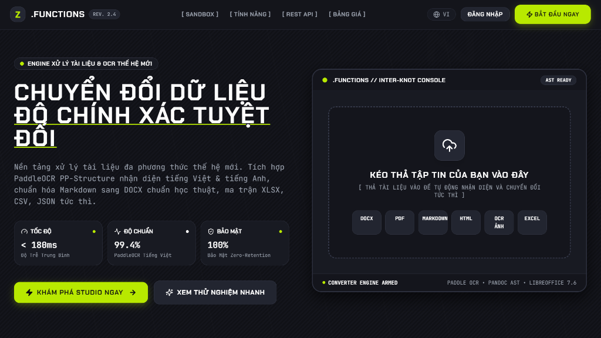
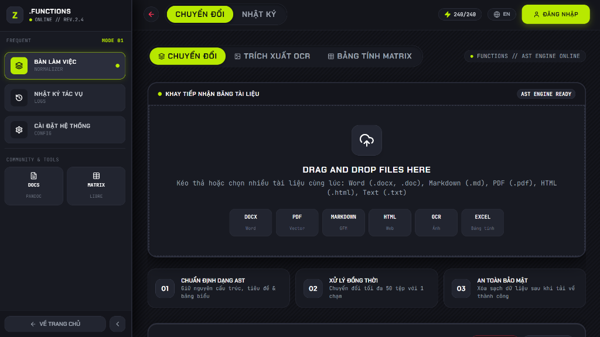
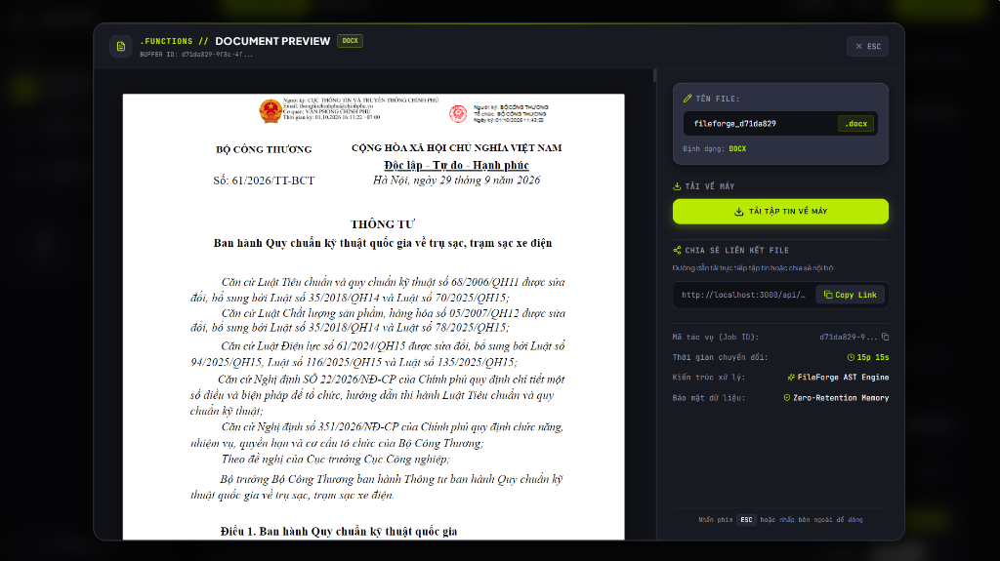

# FileForge — Nền Tảng Chuyển Đổi Tài Liệu Thông Minh & OCR Studio

<p align="center">
  
  
  
  
  
  
  
  
</p>

<p align="center">
  <strong>FileForge</strong> là hệ thống chuyển đổi tài liệu toàn diện kết hợp công nghệ OCR trí tuệ nhân tạo (PaddleOCR PP-Structure, SLANet, Tesseract Best & VietOCR), hỗ trợ xử lý chuyên sâu cho tiếng Việt và tiếng Anh. Dự án cung cấp đầy đủ giao diện Web Studio hiện đại (phong cách Glassmorphism / Aurora Theme) cùng hệ thống RESTful API chuẩn doanh nghiệp.
</p>

<p align="center">
  
</p>

---

## 📑 Mục lục

- [1. Giới thiệu & Tính năng nổi bật](#1-giới-thiệu--tính-năng-nổi-bật)
- [2. Ảnh chụp giao diện thực tế](#2-ảnh-chụp-giao-diện-thực-tế)
- [3. Ma trận chuyển đổi định dạng](#3-ma-trận-chuyển-đổi-định-dạng)
- [4. Pipeline xử lý OCR & Phục hồi định dạng](#4-pipeline-xử-lý-ocr--phục-hồi-định-dạng)
- [5. Kiến trúc hệ thống](#5-kiến-trúc-hệ-thống)
- [6. Công nghệ sử dụng](#6-công-nghệ-sử-dụng)
- [7. Hướng dẫn cài đặt & Khởi chạy](#7-hướng-dẫn-cài-đặt--khởi-chạy)
  - [Khởi chạy nhanh với Docker](#khởi-chạy-nhanh-với-docker-khuyến-nghị)
  - [Cài đặt thủ công (Local Development)](#cài-đặt-thủ-công-local-development)
  - [Cài đặt mô hình OCR (Tùy chọn)](#cài-đặt-mô-hình-ocr-tùy-chọn)
- [8. Tài liệu REST API](#8-tài-liệu-rest-api)
- [9. Cấu trúc thư mục dự án](#9-cấu-trúc-thư-mục-dự-án)
- [10. Roadmap phát triển](#10-roadmap-phát-triển)
- [11. Giấy phép](#11-giấy-phép)

---

## 1. Giới thiệu & Tính năng nổi bật

### 📄 Chuyển đổi tài liệu đa năng (Document Conversion)

- Hỗ trợ chuyển đổi qua lại giữa: **Markdown, DOCX, PDF, HTML, TXT, RTF**.
- Tự động bảo toàn cấu trúc phân cấp (Heading 1-6), font chữ, màu sắc, danh sách đa cấp, blockquote và bảng biểu phức tạp.
- Xuất bản PDF chất lượng in ấn thông qua **WeasyPrint** và **LibreOffice**.

### 📊 Xử lý bảng tính linh hoạt (Spreadsheet Engine)

- Hỗ trợ định dạng: **XLSX, CSV, JSON, ODS**.
- Trích xuất dữ liệu bảng lồng nhau (nested JSON), tự động nhận diện kiểu dữ liệu (Date, Currency, Number).

### 🔍 OCR Studio thông minh (ML-Powered OCR)

- **Bảo toàn định dạng ≥ 95%**: Không chỉ nhận diện chữ mà còn khôi phục nguyên vẹn cấu trúc văn bản gốc (vị trí tọa độ, canh lề, cỡ chữ, font serif / sans-serif).
- **Phục hồi bảng biểu 1:1 (Table Structure Recovery)**: Ứng dụng mô hình **SLANet** nhận diện chính xác các ô bị merge (rowspan, colspan), đường viền bảng và xuất trực tiếp ra Word/Excel.
- **Tối ưu tiếng Việt chuyên sâu**:
  - Tự động nhận diện và sửa lỗi dấu thanh tiếng Việt bị đứt gãy hoặc mờ nhạt.
  - Phân tách chính xác chú thích chân trang (Footnotes) và số trang.
  - Hỗ trợ module nhận diện chữ viết tay (VietOCR) kèm cảnh báo highlight `needs_review` trên giao diện người dùng.

### ⚡ Xử lý bất đồng bộ & Hiệu năng cao

- Xử lý hàng đợi tác vụ nền với **Celery + Redis**, hỗ trợ theo dõi tiến trình (Progress bar) theo thời gian thực.
- Hỗ trợ Webhook tự động thông báo khi tác vụ hoàn thành.

---

## 2. Ảnh chụp giao diện thực tế

### 🚀 Bàn làm việc & Băng tải tiếp nhận tài liệu (Workspace Console)

Giao diện làm việc trực quan hỗ trợ kéo thả tệp, phân luồng chuẩn hóa định dạng AST và tùy chọn chuyển đổi tức thì:
<p align="center">
  
</p>

### 📄 Trình xem trước & Đối chiếu văn bản thông minh (Smart Document Preview)

Xem trước kết quả trực quan ngay trên nền tảng với độ chính xác cao về bố cục quy chuẩn, font chữ và metadata chi tiết:
<p align="center">
  
</p>

---

## 3. Ma trận chuyển đổi định dạng

Hệ thống hỗ trợ chuyển đổi linh hoạt giữa nhiều định dạng văn bản, dữ liệu và hình ảnh:

| Đầu vào (From) \ Đầu ra (To) | DOCX | PDF | HTML | Markdown | XLSX | CSV | JSON | TXT |
| :--- | :---: | :---: | :---: | :---: | :---: | :---: | :---: | :---: |
| **Markdown** | ✅ | ✅ | ✅ | — | — | — | — | ✅ |
| **HTML** | ✅ | ✅ | — | ✅ | — | — | — | ✅ |
| **PDF** | ✅ | — | ✅ | ✅ | — | — | — | ✅ |
| **DOCX** | — | ✅ | ✅ | ✅ | — | — | — | ✅ |
| **XLSX** | ✅ | ✅ | ✅ | ✅ | — | ✅ | ✅ | ✅ |
| **CSV** | ✅ | ✅ | ✅ | ✅ | ✅ | — | ✅ | ✅ |
| **JSON** | — | — | — | — | ✅ | ✅ | — | ✅ |
| **Image (PNG/JPG/TIFF)** *(OCR)* | ✅ | ✅ | ✅ | ✅ | ✅ | — | ✅ | ✅ |
| **ODS / RTF / TXT** | ✅ | ✅ | ✅ | ✅ | ✅ | ✅ | ✅ | ✅ |

---

## 4. Pipeline xử lý OCR & Phục hồi định dạng

```
                             HÌNH ẢNH / TÀI LIỆU QUÉT
                                        │
                                        ▼
┌─────────────────────────────────────────────────────────────────────────────┐
│ 1. Tiền xử lý ảnh (ML-Enhanced Preprocessing)                               │
│    • Tự động xoay & căn thẳng góc nghiêng (Auto-Deskew & Rotation)          │
│    • Tăng cường độ tương phản cục bộ thích ứng (Adaptive CLAHE/Retinex)     │
│    • Khử nhiễu đốm hạt (Denoise) & chuẩn hóa DPI                            │
└──────────────────────────────────────┬──────────────────────────────────────┘
                                       │
                                       ▼
┌─────────────────────────────────────────────────────────────────────────────┐
│ 2. Phân tích bố cục tài liệu (PP-Structure Layout Analysis)                 │
│    • Phân đoạn các khối: Đoạn văn (Paragraph), Bảng (Table), Ảnh, Tiêu đề   │
│    • Phát hiện Header / Footer / Chú thích chân trang (Footnotes)           │
│    • Nhận diện bố cục nhiều cột (Multi-column flow)                         │
└──────────────────────────────────────┬──────────────────────────────────────┘
                                       │
                                       ▼
┌─────────────────────────────────────────────────────────────────────────────┐
│ 3. Nhận dạng ký tự & Cấu trúc bảng (Recognition Engine)                     │
│    • PaddleOCR DB++: Bóc tách text tiếng Anh (≥99%) & tiếng Việt (≥95%)     │
│    • SLANet: Tái lập mạng lưới ma trận ô bảng, giải mã ô gộp (Merged Cells) │
│    • VietOCR Transformer: Hỗ trợ bóc tách chữ viết tay (Handwriting)        │
└──────────────────────────────────────┬──────────────────────────────────────┘
                                       │
                                       ▼
┌─────────────────────────────────────────────────────────────────────────────┐
│ 4. Hậu xử lý & Tái cấu trúc tài liệu (Document Reconstruction)              │
│    • Đo lường & suy đoán Font chữ (Times New Roman, Arial, Calibri, ...)    │
│    • Bảo toàn kích thước chữ, in đậm (Bold), in nghiêng (Italic), gạch chân │
│    • Chuẩn hóa dấu câu tiếng Việt & giải quyết ngữ cảnh mập mờ              │
└──────────────────────────────────────┬──────────────────────────────────────┘
                                       │
                                       ▼
                       XUẤT KẾT QUẢ: DOCX / PDF / XLSX / HTML
```

---

## 5. Kiến trúc hệ thống

```
┌─────────────────────────────────────────────────────────────────┐
│                     Frontend (React + Vite SPA)                 │
│         Aurora Glassmorphism UI • OCR Studio • Dashboard        │
└───────────────────────────────┬─────────────────────────────────┘
                                │ HTTPS / REST API
┌───────────────────────────────▼─────────────────────────────────┐
│                 API Gateway / Reverse Proxy (Nginx)             │
└───────────────────────────────┬─────────────────────────────────┘
                                │
        ┌───────────────────────┴───────────────────────┐
        │                                               │
┌───────▼───────────────────────┐           ┌───────────▼─────────┐
│   Core Backend (FastAPI)      │           │  Task Queue (Redis) │
│   • Xác thực JWT              │           │  • Điều phối Job    │
│   • Quản lý tệp & Metadata    │           │  • Lưu trạng thái   │
│   • Phân phối tác vụ          │           └───────────┬─────────┘
└───────┬───────────────────────┘                       │
        │                                   ┌───────────▼─────────┐
        │                                   │ Celery Worker Fleet │
        │                                   │ • OCR Pipeline      │
        │                                   │ • LibreOffice/Pandoc│
        │                                   │ • Data Processing   │
        │                                   └───────────┬─────────┘
        │                                               │
┌───────▼───────────────────────┐           ┌───────────▼─────────┐
│   PostgreSQL Database         │           │ S3 / MinIO Storage  │
│   • Users, Jobs, History      │           │ • Lưu tệp gốc & kết │
│   • Cấu hình & phân quyền     │           │   quả chuyển đổi    │
└───────────────────────────────┘           └─────────────────────┘
```

---

## 6. Công nghệ sử dụng

| Phân hệ | Công nghệ | Chi tiết sử dụng |
| :--- | :--- | :--- |
| **Backend API** | **FastAPI (Python 3.11+)** | REST API bất đồng bộ tốc độ cao, xác thực JWT, OpenAPI Docs |
| **Hàng đợi tác vụ** | **Celery + Redis** | Điều phối tiến trình chuyển đổi và OCR ngầm không gây nghẽn API |
| **Cơ sở dữ liệu** | **PostgreSQL 16** | Quản lý người dùng, nhật ký chuyển đổi, metadata tài liệu |
| **Lưu trữ tệp** | **MinIO / S3 Compatible** | Lưu trữ tệp tải lên và tệp đầu ra an toàn |
| **Frontend UI** | **React 18 + TypeScript + Vite** | Giao diện Single Page Application tối ưu tốc độ tải |
| **Styling** | **TailwindCSS + Framer Motion** | Hiệu ứng chuyển động mượt mà, theme Aurora Glassmorphism |
| **OCR & AI** | **PaddleOCR, SLANet, VietOCR** | Nhận diện ký tự, bóc tách cấu trúc bảng biểu và chữ viết tay |
| **Bộ chuyển đổi** | **Pandoc, WeasyPrint, PyMuPDF** | Xử lý tài liệu văn phòng, HTML sang PDF chuẩn in ấn |

---

## 7. Hướng dẫn cài đặt & Khởi chạy

### Khởi chạy nhanh với Docker (Khuyến nghị)

Toàn bộ hệ thống (Frontend, Backend, PostgreSQL, Redis, MinIO, Celery Worker) đã được cấu hình sẵn sàng trong Docker Compose:

```bash
# 1. Clone mã nguồn dự án
git clone https://github.com/ngominh123asd/FullCFile.git
cd FullCFile

# 2. Tạo tệp cấu hình môi trường từ mẫu
cp .env.docker .env

# 3. Khởi động toàn bộ dịch vụ
docker compose up -d --build
```

Sau khi khởi động thành công, các dịch vụ sẽ có sẵn tại:

- **Giao diện Web**: [http://localhost:3000](http://localhost:3000)
- **Tài liệu Swagger API**: [http://localhost:8000/docs](http://localhost:8000/docs)
- **Trang quản trị MinIO**: [http://localhost:9001](http://localhost:9001) *(Tài khoản mặc định: `minioadmin` / `minioadmin123`)*

---

### Cài đặt thủ công (Local Development)

#### Yêu cầu hệ thống

- Python 3.11+
- Node.js 18+ & npm
- PostgreSQL 15+ & Redis 7+
- LibreOffice & Pandoc *(nếu chạy module chuyển đổi DOCX/PDF)*

#### Bước 1: Khởi chạy Backend

```bash
cd backend

# Khởi tạo môi trường ảo
python -m venv venv
# Kích hoạt môi trường ảo:
# Trên Windows:
.\venv\Scripts\activate
# Trên Linux/macOS:
source venv/bin/activate

# Cài đặt thư viện
pip install -r requirements.txt

# Thiết lập biến môi trường
cp .env.example .env

# Chạy máy chủ FastAPI
uvicorn app.main:app --reload --host 0.0.0.0 --port 8000
```

Khởi chạy Celery Worker (ở một terminal khác):

```bash
cd backend
celery -A app.workers.celery_worker worker --loglevel=info
```

#### Bước 2: Khởi chạy Frontend

```bash
cd frontend

# Cài đặt gói phụ thuộc
npm install

# Khởi chạy Vite dev server
npm run dev
```

Mở trình duyệt tại [http://localhost:3000](http://localhost:3000) để sử dụng ứng dụng.

---

### Cài đặt mô hình OCR (Tùy chọn)

Để tăng cường độ chính xác cho tiếng Việt cổ / tài liệu scan mờ và chữ viết tay, bạn có thể tải thêm các model cục bộ:

```bash
docker compose exec backend python scripts/setup_ocr_models.py
docker compose restart backend celery-worker
```

*Các mô hình được tải tự động theo checksum mã hóa SHA-256 đã kiểm duyệt.*

---

## 8. Tài liệu REST API

API cung cấp đầy đủ các endpoint xử lý tài liệu. Dưới đây là các tác vụ tiêu biểu:

### 1. Tải tệp lên hệ thống

```bash
curl -X POST "http://localhost:8000/api/v1/files/upload" \
  -H "Authorization: Bearer <YOUR_TOKEN>" \
  -F "files=@document.pdf"
```

### 2. Gửi yêu cầu chuyển đổi định dạng

```bash
curl -X POST "http://localhost:8000/api/v1/convert" \
  -H "Authorization: Bearer <YOUR_TOKEN>" \
  -H "Content-Type: application/json" \
  -d '{
    "input_file_id": "3fa85f64-5717-4562-b3fc-2c963f66afa6",
    "output_format": "docx",
    "options": {
      "preserve_formatting": true,
      "table_style": "grid"
    }
  }'
```

### 3. Phân tích bố cục & OCR tài liệu

```bash
# Phân tích sơ bộ bố cục ảnh
curl -X POST "http://localhost:8000/api/v1/ocr/analyze" \
  -H "Authorization: Bearer <YOUR_TOKEN>" \
  -H "Content-Type: application/json" \
  -d '{"input_file_id": "3fa85f64-5717-4562-b3fc-2c963f66afa6"}'

# Thực hiện OCR đầy đủ kèm tái tạo cấu trúc bảng biểu
curl -X POST "http://localhost:8000/api/v1/ocr/process" \
  -H "Authorization: Bearer <YOUR_TOKEN>" \
  -H "Content-Type: application/json" \
  -d '{
    "input_file_id": "3fa85f64-5717-4562-b3fc-2c963f66afa6",
    "language": "vi",
    "output_format": "docx",
    "preserve_layout": true,
    "preserve_tables": true
  }'
```

### 4. Kiểm tra trạng thái & Nhận kết quả

```bash
curl -X GET "http://localhost:8000/api/v1/jobs/<JOB_ID>" \
  -H "Authorization: Bearer <YOUR_TOKEN>"
```

---

## 9. Cấu trúc thư mục dự án

```
FullCFile/
├── backend/                       # Backend FastAPI
│   ├── app/
│   │   ├── api/v1/endpoints/     # Các Route API (Auth, Files, Convert, OCR, ...)
│   │   ├── core/                 # Cấu hình hệ thống, bảo mật JWT, kết nối DB
│   │   ├── models/               # SQLAlchemy ORM Models
│   │   ├── schemas/              # Pydantic Schemas xác thực dữ liệu
│   │   ├── services/             # Logic nghiệp vụ (OCR, Typography, Conversion)
│   │   └── workers/              # Celery tasks xử lý ngầm
│   ├── fonts/                    # Bộ font TrueType hỗ trợ chuẩn hóa văn bản
│   ├── scripts/                  # Script tự động (tải OCR models, migration)
│   ├── tests/                    # Bộ kiểm thử đơn vị & kiểm thử tích hợp
│   ├── Dockerfile                # Cấu hình container Backend
│   └── requirements.txt          # Danh sách thư viện Python
├── frontend/                      # Frontend React + TypeScript
│   ├── src/
│   │   ├── components/           # UI Components (GlassCard, Buttons, DropZone)
│   │   │   ├── features/         # OCR Studio, Document Converter, Table Preview
│   │   │   └── layout/           # Sidebar, Navbar, Page Containers
│   │   ├── lib/                  # Tiện ích API client & format dữ liệu
│   │   └── styles/               # CSS Tokens & Global Tailwind styles
│   ├── package.json              # Quản lý dependencies Frontend
│   └── vite.config.ts            # Cấu hình Vite bundler
├── docx-formatter/                # Module bổ trợ định dạng tài liệu DOCX thông minh
├── docker-compose.yml             # Cấu hình khởi chạy các dịch vụ production
├── docker-compose.dev.yml         # Cấu hình hot-reload môi trường phát triển
├── Makefile                       # Phím tắt dòng lệnh tiện dụng
├── SPEC.md                        # Tài liệu đặc tả kỹ thuật nội bộ chi tiết
└── README.md                      # Hướng dẫn & Giới thiệu tổng quan dự án
```

---

## 10. Roadmap phát triển

- [x] **Giai đoạn 1**: Xây dựng kiến trúc cốt lõi FastAPI + Celery + React.
- [x] **Giai đoạn 2**: Tích hợp module chuyển đổi đa định dạng (Markdown, DOCX, PDF, XLSX, JSON).
- [x] **Giai đoạn 3**: Hoàn thiện OCR Studio với nhận diện bảng biểu SLANet, bảo toàn font chữ tiếng Việt.
- [ ] **Giai đoạn 4**: Hỗ trợ xử lý văn bản quy mô lớn (Batch document processing >1000 trang song song).
- [ ] **Giai đoạn 5**: Ứng dụng mô hình LLM hỗ trợ tóm tắt tài liệu & sửa ngữ pháp tự động sau khi OCR.

---

## 11. Giấy phép

Dự án được phân phối dưới giấy phép **Apache License 2.0**. Mọi cá nhân và tổ chức đều có quyền tự do sử dụng, chỉnh sửa và phân phối theo các điều khoản của Apache 2.0. Chi tiết xem tại tệp [LICENSE](LICENSE).
